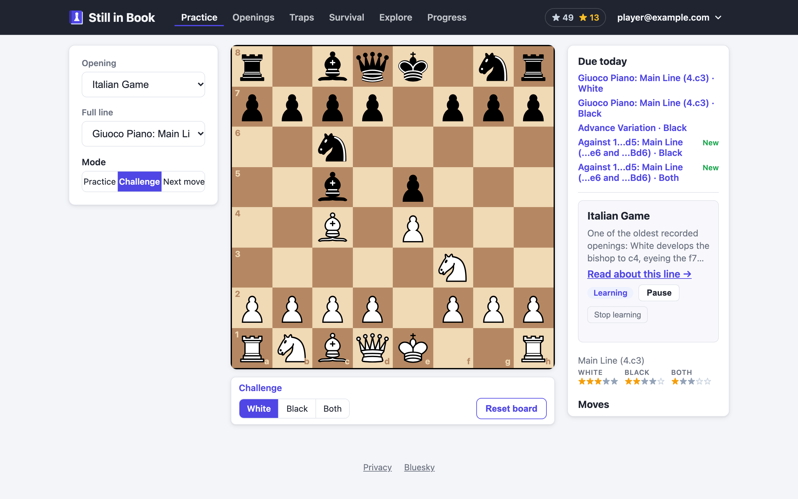

### Hi, I'm Erik 👋

I'm building **[Still in Book](https://stillinbook.com?utm_source=github&utm_campaign=profile)**, a free chess opening trainer.

You learn an opening one line at a time by playing it from memory, as White, as Black and with both colors, and watch each line go from zero stars to mastered. Lines you're learning come back for review at growing intervals, sooner after a mistake.

- **22 openings, 167 lines**, from the Italian and the Sicilian to the London and the English, each with its own page
- **Traps:** learn the moves, dodge them as the victim, and practice setting them
- **Survival:** play the book for as long as you can without leaving it
- **Explore:** every book move from any position, with the openings it leads to
- **Your Chess.com games:** see which openings you play, where you leave the book, and what to practice next

Built solo with [Claude Code](https://claude.com/claude-code): Ruby (Sinatra), SQLite and one small server, with the openings as YAML files.
